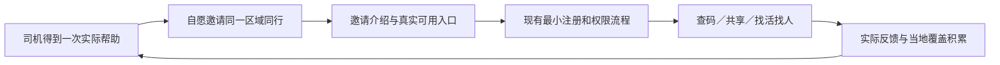

# Abasong V3.2 邀请司机功能方案

2026-11-05。用户要求新增“邀请司机”菜单，让司机基于真实价值把产品分享给同行。方案已获用户确认，r3-invite交互原型已制作：[邀请页](../../design/abasong-independent-v1/v12.1-experience/index.html?v=r3-invite&task=invite)、[接收页](../../design/abasong-independent-v1/v12.1-experience/index.html?v=r3-invite&task=invite-receive)。20项浏览器检查通过，待用户体验确认；**实际App/API/数据库/域名/分发未改，未向任何人发送邀请。**

2026-11-06 B5-05 已实现原生入口、二维码海报保存、系统分享与复制，以及不需登录的静态接收页。双端使用合成资料验收，正常构建尚未开放分享与下载。见[本轮实施验收](../technical/B5_05_邀请司机与接收页实施验收.md)。

2026-11-08 M6-02 已完成邀请页面的品牌、层次、窄屏组件收敛和接收页保护复核；普通构建仍关闭真实分享与下载，邀请不会获得门禁查看资格。共享字标和插画、主操作及可换行次级操作按 Muse/V3.3 视觉基准实现；系统分享／照片保存本轮原生补验待解锁。见[消息与邀请验收](../technical/V3.5_M6-02_消息邀请与未读语义验收.md)。下文2026-11-05原型状态保留为历史，不代表原生仍未开发。

产品边界沿用[产品基线](../../产品基线.md)与[我的及团队规则](Abasong_V3.2_我的与团队资料补充.md)。邀请是产品推荐，不是加入DSP、接受配送任务、增加好友、重建常联系名单或自动获得门禁资料资格。

## 1. 要解决的问题与首版取舍

司机在仓库、线路、微信群里已经认识同行。首版应让他用一句话说明“为什么值得装”，用一次分享或一张二维码邀请图把对方带到可信的产品介绍和实际可用入口；受邀者先理解价值，进入App后尽快完成自己的查码/共享/找活找人任务。

增长假设：同一区域/仓库的司机因为一次有帮助的使用而自愿推荐，新增司机实际使用和共享，才可能进一步改善当地覆盖与协作供给。这不是已验证的增长结果，不能用注册量代替有效资料或司机回应。

| 首版必须 | 首版不做 | 后续有证据再考虑 |
|---|---|---|
| 我的邀请入口、分享文案＋HTTPS链接、二维码邀请图、图片保存、接收邀请页和真实可用入口 | 邀请码输入、邀请人数解锁查码、现金/积分返佣、排行榜、通讯录/群发、绑定团队、谁邀请了谁的名单 | 个人专属来源、自愿认领的精确归因、真实有效的奖励实验 |

**推荐先用通用邀请链接和通用二维码，不做个人邀请码或个人邀请统计。** 它已能完成司机相互推荐，避免为了归因先增加注册步骤和关系数据。以后若确需奖励或个人效果统计，再单独设计归因规则；不能把早期通用链接的点击追认成某人的邀请成果。

## 2. 入口及触发

“我的”维持：个人资料 → 接活开关 → 蓝色共享门禁码 → 同组我的公寓/我的发布/我的报名 → 次级分组“邀请司机、我的团队” → 设置。

邀请是普通菜单行，名称“邀请司机”，可用分享图标；不增加底部导航或另一个醒目的根页蓝色按钮，不打断查码、共享或报名。司机与DSP使用同一个入口，DSP可自行转发给其认识的司机，不建立团队邀请/成员流程。

第一版只设常驻菜单。后续可在一次“有用”反馈或共享成功后实验一次轻量推荐，但不能遮挡结果、不连续弹窗、不默认勾选、不要求邀请才能继续使用。触发实验不作为首版前置任务。

## 3. U15 邀请司机页（合成原型已制作）

U15已进入活动目录；旧U12–U14历史合并编号不重新占用。新增两页后为40节点/374状态要求。

| 层级 | 内容/交互 |
|---|---|
| 顶部 | 返回；标题“邀请司机” |
| 主标题 | **到了公寓进不去？先看看同行共享的门禁码。** |
| 简短价值 | 附近公寓查码；截图或手填共享；有空找活、送不完找人。只展示当前分发版本真正可用的能力 |
| 邀请图预览 | Abasong品牌、同一价值主张、三个短价值点、二维码和“扫码了解 Abasong” |
| 主要操作 | “分享邀请”：由本人打开系统分享面板，选择接收对象 |
| 次级操作 | “保存邀请图”；“复制文案与链接” |
| 一处补充 | “门禁资料由同行共享，覆盖持续积累。”不显示假数量、假评价或保收入承诺 |

沿用V3.2皇家蓝/黑白灰、现有Header/Buttons/StatusPanel、20边距与48热区，自然高度页面，保存/分享操作可达。邀请图不使用真实门禁码、私人住址、精确位置、真实聊天截图或登录号码；用通用建筑插画，避免从当前屏幕截取敏感内容。

页面已显示二维码，仓库见面时可让对方直接扫描；不另设一个功能重复的扫码页面，也不为展示二维码申请相机/通讯录权限。二维码与复制/分享链接指向同一接收邀请页。

## 4. 可直接用于原型的文案

**通用邀请文案：**

> 跑快递遇到公寓进不去，可以看看 Abasong：查附近公寓的共享门禁码，也能通过截图或手填，把自己有权共享的资料加进去。有空找活、送不完找人，和跑同一区域的同行一起用。
>
> [实际可用的邀请链接]

正式分享时，未开放的找活/找人等能力从文案和海报中移除；不提前宣传未来功能。邀请人可在外部消息里自行补充自己的体验，App不自动附加个人资料。

**邀请图：** Abasong → “公寓进不去？先查同行共享的门禁码” → “查码 · 共享 · 找活找人”（按实际开放能力裁剪）→ 二维码 → “扫码了解 Abasong”。不设计现金、红包或邀请排名视觉。

**分享预览标题：**“Abasong｜跑配送的同行，一起少走弯路”。

**分享预览摘要：**“查附近公寓的共享门禁资料，让下一次配送多一个办法。”

上述是待验证的中文文案，不宣称每栋有资料、注册即有查看资格或必然能找到人。英文版本在该语言实际启用时制作，不增加首版语言切换流程。

## 5. X02 接收邀请页（合成原型已制作）

X02作为浏览器公开落地页目标，不要求先登录才能了解产品。它与G02/X01的“分享某条配送需求”是不同页面，不携带需求、仓库地址、报价或门禁记录。

内容顺序：价值主标题 → 一张通用界面示意图 → 简短核心价值 → 当前平台的可用入口 → 资料来源/使用条件及隐私/联系入口。示意图不能让人误以为已获得某个真实公寓的门禁资料。

| 接收者/发布状态 | 结果 |
|---|---|
| 已安装、关联有效 | 标准HTTPS链接可进入Abasong；未登录保留最小来源后走现有登录，不增加邀请码输入 |
| 未安装、有已验证的正式商店地址 | 看到产品介绍及相应iOS/Android下载入口；安装后可直接从App图标进入首页 |
| 已具备可用受邀内测分发 | 清楚写“内测版”，只提供实际有效且有权分发的入口及现有使用条件 |
| 尚无可用分发包或某一平台未开放 | 保留产品介绍和真实状态，不放无效下载、Metro URL或假“立即加入”按钮；不新建收手机号候补系统 |
| 微信内置浏览器打开/跳转受阻 | 留在可读介绍页，提供复制链接/使用浏览器打开的简短操作；实际行为另做真机测试 |
| 链接异常/渠道参数非法 | 不暴露内部错误，回通用产品介绍；不跳往外部任意URL |

域名/路径暂规划为第一方HTTPS的`/invite`，**不是已部署的可分享地址**。实际采用哪个主机和商店/内测URL，要在实施时核对控制权、现有主站部署及分发状态；本轮不调整www、DNS、证书或云资源。

## 6. 受邀后的首次价值

不把“打开分享面板”当作邀请成功，也不把“下载安装”当作留存。受邀司机进入App后继续现有最小账号和首页流程：可选使用时定位、手动搜索、附近卡片及真实权限状态；不先要求完成司机简历、建团队、邀请别人或上传所有门禁资料。

有码时允许有权查看的司机核对和反馈；无码时保留地址与添加入口，允许继续查其他地址；无资格时如实说明当前条件，不用邀请来源绕过资格。共享由本人确认后直接发布，不以邀请人数或贡献条数换取资格。

这是待验证的产品循环，不是自动增长保证。新司机查不到资料时的挫折不能靠更强宣传弥补，邀请投放与真实覆盖、资料质量及首次使用体验一起看。

## 7. 分享及异常规则

| 状态 | 行为 |
|---|---|
| 打开邀请页 | 不自动发送、不访问通讯录、不请求照片/相机权限 |
| 系统分享打开 | 用户选应用和接收者；不固定写成已发送到微信 |
| 取消分享/返回 | 留在邀请页，不显示“邀请成功”或增加人数 |
| 分享不可用 | 提供复制文案与链接、保存邀请图作为替代；不自动改发短信 |
| 保存图片 | 只有本人点保存时才请求必要相册写入能力；拒绝/失败仍能使用其他分享方式 |
| 复制失败 | 原文和链接可选择，提示重试；不假装复制成功 |
| 弱网 | 本地已打包文案/图片可展示；链接是否能被对方打开由真实服务决定，不承诺离线邀请送达 |
| 已安装用户/重复打开 | 打开现有账号，不新建账号、授资格或改变团队/报名关系 |

不提供自动群发、微信自动加好友、自动发朋友圈或“已读邀请”。微信/朋友圈的实际目标可用性在系统分享和图片转发中分别核对，不用“系统回调”伪造外部平台送达。

## 8. 最小技术方案与已有工程差异

本地依赖已核对：React Native0.88.1、Expo58、expo-linking和expo-file-system已有；未发现邀请页面、邀请业务服务、专属归因模型或已配置的邀请关联域。本次只读核对，未安装依赖。

1. **链接文案分享：**复用RN内置Share和现有路由；iOS可传message/url，Android将链接明确包含在message。系统面板返回值不能证明新司机注册；官方说明Android返回动作始终为sharedAction，iOS也需要区分取消。[React Native Share](https://reactnative.dev/docs/share)
2. **二维码邀请图：**首版通用图可在构建阶段生成并打包，不需为每个司机做动态图/个性化二维码服务；文案、二维码与实际配置URL同版。图片保存所需原生写入模块及权限在实施时评估，不能把已存在的照片选择器当图片保存能力。当前不装微信SDK或新增长插件。
3. **已安装打开：**iOS用Universal Links的域名/应用双向关联；Expo要求网站AASA及应用associatedDomains配置，并用实际Team ID/构建ID/支持路径核对，不把入口核对工具配置成业务邀请目标。[Expo iOS官方文档](https://docs.expo.dev/linking/ios-universal-links/)
4. **Android关联：**配置受限HTTPS路径、autoVerify和网站assetlinks.json，签名指纹与实际发布包匹配；实际安装验证后才标可用。[Expo Android官方文档](https://docs.expo.dev/linking/android-app-links/)、[Android App Links](https://developer.android.com/training/app-links)
5. **接收页和配置：**公开页仅通用营销内容，配置阶段/已开放能力/平台下载URL/邀请图版本/固定渠道枚举；URL只允许实际受控的HTTPS目的地，不从query接受任意跳转地址。分享包不含JWT、邀请码式权限凭据、用户ID、电话、微信、精确GPS、门禁码或业务对象ID。

首版**不需要新增个人邀请业务表或邀请码认领API**，也不复用需求分享token。公开页可以是独立静态页面；部署路径/托管材料需先具体审查，不以本方案授权新增费用或主站修改。若记录第一方最小指标，复用已批准的隐私规则和现有监控边界，不自动加第三方归因SDK或设备指纹。

普通链接打开已安装App，不等于能在“下载→安装→首次启动”后恢复原链接。首版通用邀请不需要恢复个人来源；允许直接打开首页，不能借剪贴板读取、静默跟踪或额外邀请码补偿精确归因。未来确需个人来源时重新评审其价值、同意/隐私和平台实测条件。

## 9. 判断有没有带来有效司机

前台首版不显示邀请人数/邀请名单。后台只看能真实观察到的阶段，最小事件不含正文、电话/微信、门禁码或精确位置，也不采集接收者通讯录。

| 观察项 | 能说明什么 | 不等于什么 |
|---|---|---|
| invite_view / share_open / copy / poster_save | 司机发现入口及愿意推荐的操作 | 已发送给几个人或被阅读 |
| 邀请接收页访问、平台入口点击 | 有人了解/尝试获取App；机器人与重复访问分开 | 已下载、安装或成功注册 |
| 真实新账号/首次核心动作 | 新司机实际进入业务，按真实身份及权限去重 | 都来自某个司机邀请或一定获益 |
| 明确有用反馈、成功贡献、收到真实相关回复 | 核心价值信号，分别统计 | 配送履约、收入或保证可用 |
| 新用户7日内再次主动使用 | 初步复用信号，试点后记录 | 已证明长期粘性或市场增长率 |

只在可观测的同一会话内计算链路转化；跨安装来源缺失记未知。新用户激活/复用可独立统计，不能把它们全部归因给邀请。未接采集服务时填写未测，不伪造人数、邀请成功率或裂变系数。

## 10. 设计、开发和验收顺序

推荐作为首版B5增长配套，跟在核心查码/共享体验之后；不改变既有R4优先级，也不以新增邀请需求重做整个设计系统。

| 阶段 | 交付 | 出口 |
|---|---|---|
| 已确认方案 | 本文、入口位置、文案、技术边界及D21 | 用户已确认 |
| 本轮原型 | U01菜单、U15邀请页、X02接收页及异常状态已制作 | 20项合成通过，待用户体验；二维码为abasong.example保留域名，不外发 |
| B5实际实现 | 原生Share/复制/图片保存、公开页和环境配置 | 真正链接、对应构建、功能开关、必要新依赖审查及双端测试 |
| 分发验收 | 受邀内测或正式渠道、域名关联和现场设备 | 有效入口及新司机核心可用后才扩大邀请 |

**完整产品验收目标（合成原型只覆盖部分，不能把以下全标通过）：**

- AC-I01：我的中菜单位置正确，三个管理菜单仍同组，共享门禁码仍是主要操作。
- AC-I02：邀请内容只含已开放能力，外部预览无门禁正文、账号资料或业务来源。
- AC-I03：文本/链接/二维码同一配置目标，版本更新不留下相互矛盾的图片和入口。
- AC-I04：分享取消/Android回调不计邀请成功，不能自动发给任何人。
- AC-I05：保存权限拒绝、复制失败和弱网有实际可用替代，操作可取消。
- AC-I06：已装iOS/Android真实包打开正确业务端；冷启/前后台均不进入入口核对工具或Metro URL。
- AC-I07：未装时只显示有效分发入口，平台未开放无假下载；微信浏览器/朋友圈转图分别实测。
- AC-I08：公开介绍先于登录，首次注册无邀请码、强制简历/建团队/再邀请环节。
- AC-I09：新账号仍按现有资格规则，邀请不解锁门禁正文或自动授团队权限。
- AC-I10：无码/无覆盖新司机仍能搜索或自愿共享，不把注册记成查码成功。
- AC-I11：重复打开不造账号/成员/好友关系；D19取消仍保持，不生成邀请司机名单。
- AC-I12：320/390/430、长文案、200%字体、系统分享/权限/返回及可访问性分别记录；浏览器不代替原生。
- AC-I13：渠道参数白名单、无开放重定向，日志/指标不含敏感内容，关联路径限定。
- AC-I14：分发不可用时停止正式外发；统计缺环节标未知，不用旧112项检查作为本功能证据。

追踪：G21/D21、UP18/UX16、C146–155；40活动节点/374状态要求。邀请20项合成＋既有112项本轮回归通过；真实原生分享、保存、链接分发、微信和人测均未验。[范围与实际报告](../../design/abasong-independent-v1/v12.1-experience/邀请验收记录.md)。
