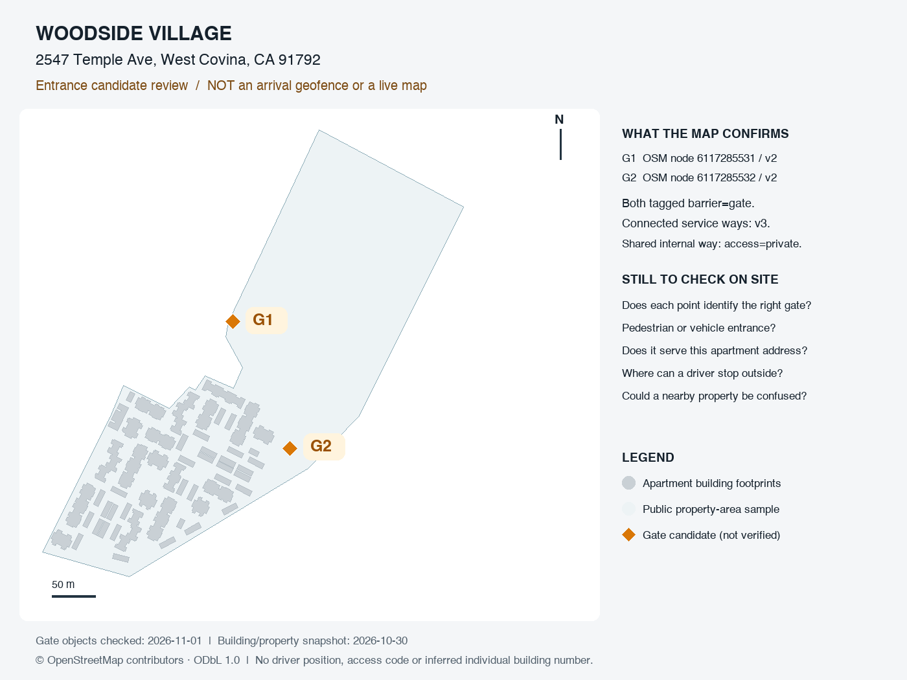

# Woodside：现场入口核对与 iPhone 连接准备

2026-11-01。用户选择近期正常配送会经过的Woodside Village，公开主地址为2547 Temple Ave, West Covina, CA 91792。选择样本不等于入口已核定；本文件不启用正常自动识别，不要求用户专程前往。

## 第一步：下次经过时核对公开入口

G1/G2来自已保存的公开OSM gate点。图中的建筑足迹、物业范围和两个门分别是不同资料，不推断每栋楼都使用2547门牌；不将两个点周围画圆当成已核定区域。公开来源及版本见[入口复核](D1_公开入口复核与停留稳定性修正.md)和[数据说明](../../data/public-apartments/README.md)。

正常配送、停车后，只需反馈以下公开事实，不需要真实密码、收件人信息或个人坐标：

1. G1、G2中哪个对应实际可用于配送的入口？可以答“G1”“G2”“两个都是”或“不确定/都不是”。不确定时不启用。
2. 该入口服务整个Woodside，还是仅服务部分楼栋/区域？不清楚可保留未知；不能从社区主地址推定密码适用全部楼栋。
3. 一般是在门外人行道、外部车道，还是门内才停下查看密码？这是门外识别范围的核对信息，不要求进入陌生区域或测试门禁。

这一步只核对门和服务范围。现在正常自动认定仍关闭，不能将App尚未自动出卡算作现场算法失败。确认后还要以公开可用边界/实测核对确定到达范围，而不是直接放大最近邻阈值。

## 第二步：先准备可用连接，再通知打开 App 测试

现有iPhone是开发客户端，API3002/Metro8082运行在Mac的已授权局域网。离开同一局域网后，公网/蜂窝网络不能访问Mac私网地址；当前没有独立离线业务后端，也没有已部署的现场测试API。缓存地图不等于服务端公寓匹配和密码查询可以离线。

因此暂不要求用户到现场输入开发URL、反复登录或直接验证自动卡片。下一批先交付可用的现场验收连接/安装方案，并在现场前实际验证：启动不依赖手输URL、登录与API可达、样本范围/到期可核查、只含授权合成资料。云端写入/部署、公网开放与账号能力变更仍须明确环境授权；现有局域网授权不能扩展成公网授权。尚未交付这些条件，不标记现场端到端已就绪。

若现场使用Mac同行的本地测试环境，仍需事先核对可信同网及API/Metro可达，不默认要求司机带Mac。优先安排司机只用手机的验收方式；具体实施与实际检查另记，不把本计划当作已安装的独立包。

## 第三步：条件满足后进行 iPhone 到达验收

| 动作 | 预期 |
|---|---|
| 接近入口、尚在移动 | 蓝点持续更新，不提前显示其他公寓密码 |
| 门外正常停稳 | 对应地址单行门牌+街道，已有正确建筑关联时高亮；不将门外区域画成建筑 |
| 有授权TEST资料 | 自动显示TEST密码及贡献人；无资料准确显示暂无共享密码和添加入口 |
| 手动拖图/展开卡片 | 不抢视野；展开锁定阅读，定位继续 |
| 主动定位、离开入口 | 定位回蓝点并解除阅读锁定；自动卡与高亮离开后撤下，慢响应不能恢复旧码 |
| 暂时断网/回前台 | 蓝点与业务失败分别显示，不冒充暂无密码；恢复后重新确认对象 |

记录公开候选编号、动作结果、必要耗时即可；本批不建立司机GPS轨迹或导入真实门禁。Android实体设备仍待，不以模拟器替代。
