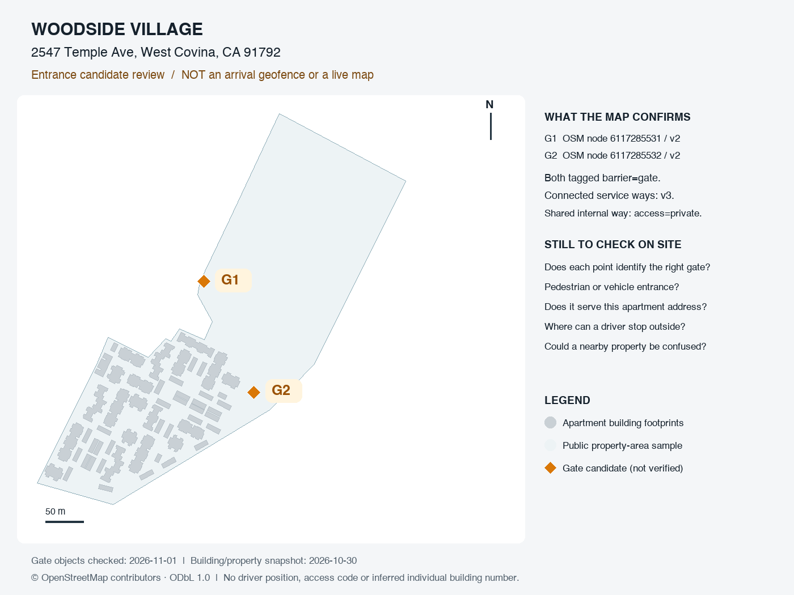

# D1 公开入口复核与停留稳定性修正

日期：2026-11-01；分支 `codex/d1-iphone-validation`。首页自动查码主线，按[ADD-10](../product/Abasong_V12.1_首页自动查码场景补充.md)推进。拍面单Android标准返回已另行补验，本批不扩大相机功能。

## 本批结果

1. 实际读取官方OSM API，重新核对Woodside两处gate节点和关联道路；保留脱除贡献者等无关字段的候选点数据，未将其写入正常开发库或启用到达范围。
2. 发现并修正原生共用停留判断只累计同一公寓ID的问题。两个门相隔约160米，却属于同一公寓，旧逻辑在两次观测相隔9秒时直接出卡。新增回归先实际失败，修正后通过。
3. 停留同时要求同公寓、同建筑/入口识别依据、同配置版本，以及当前观测在起始观测15米内；明显移动或累计移动超过该窗口时重新开始8秒停留。窗口以起始点而非上一观测点为锚，避免每次小移动累计成假停留。非法坐标或缺失识别依据不出卡。只在前台内存使用观测点，不写日志或轨迹。
4. 继续由服务端决定是否可匹配，客户端不提升候选；已有手动阅读锁定、定位按钮恢复自动选择和离开清卡规则保留。15米/8秒为开发参数，现场校准前不当作行驶分类、地理围栏或普遍准确率证明。

## 公开证据及边界

| 候选 | 本次官方API结果 | 与既有建筑/物业样本的关系 |
|---|---|---|
| G1：node6117285531 | v2，`barrier=gate`；关联service way652536538/v3、652536539/v3 | 点在既有物业区域内、54栋足迹之外 |
| G2：node6117285532 | v2，`barrier=gate`；关联service way652536537/v3、652536539/v3 | 同上；与G1不是同一个停留位置 |

关联的内部way652536539为`access=private`。官方物业站点确认Woodside名称与公开地址；这些信息不能单独证明行人配送入口、可停留范围或密码适用楼栋。gate对象更新时间仍为2020/2021，道路为2024，不能把2026-11-01核对日期说成上游新近实测。

数据：[候选GeoJSON](../../data/public-apartments/woodside-entrance-candidates.geojson)，每点保持`status=candidate`、`field_verified=false`，仅为Point，没有入口Polygon。ODbL及来源见[数据说明](../../data/public-apartments/README.md)。原始响应只在忽略目录保留已筛选字段，不保存OSM贡献者身份、司机GPS或门禁。

[SVG图](figures/woodside-entrance-review.svg)。灰色为既有公寓建筑足迹，浅色区域为已有公开物业样本，橙色G1/G2为待现场核对的门。建筑/物业沿用2026-10-30快照；本图不是产品实时地图，没有为各栋楼推断2547门牌，也没有画8米测试范围。

## 实际验证

| 项目 | 本次执行结果 |
|---|---|
| 故障复现 | 新增真实两门点回归：旧逻辑1失败/10通过，错误提前出卡；修正后停留测试14通过 |
| 完整工程检查 | `./scripts/dev check`通过：lint、工作区/脚本typecheck、150测试/25文件、build |
| 实际HTTP/数据库 | `./scripts/dev verify:library-api`：224项通过，含新增28次公开门点请求；另8项编译后地址匹配/PostGIS检查通过 |
| 新增入口覆盖 | 无入口范围/仅pending均不自动认定；隔离合成范围内8秒稳定才出卡；同社区G1→G2重计时；定位误差跨范围、粗略位置、竞争公寓、来源无核对/未来核对/过期、入口过期/撤回、无启用范围均不出卡或清除旧自动卡；手动阅读锁定仍保留 |
| JS产物 | iOS/Android/Web全部导出通过 |
| 目录/契约 | 静态校验39节点/292状态、83路径/108操作/128模型及本地链接通过；未新增接口/DDL |
| 图示 | 从公开样本生成SVG/PNG并实际查看，G1/G2及图例可辨认 |
| 原生页面 | 此批起初因Mac锁屏待验；随后用户解锁，三项核心场景已完成双端模拟器TEST补验，条件与证据见[专项记录](D1_移动停稳离开双端原生补验.md)。未把JS导出算成原生构建，未替代现场验收 |

新增HTTP测试仅在`abasong_d1_library_test_*`一次性本地库运行，函数还独立检查该库名；8米测试范围、测试来源和竞争公寓全部是隔离合成资料，不是现场入口证据。场景结束删除本批测试数据并恢复隔离库配置，外层再清理整个一次性库；不接触正常D0/云端配置、账号能力或共享密码。

首轮回归试图把`persistent_use_approved`改为false，被数据库已有许可约束拒绝；已改为验证该拒绝必须发生，再以未核对/未来/过期来源检查读取保护，没有删除约束或放宽许可。测试诊断只增加源码行位置，不打印响应内容、连接串或敏感资料。

## 现场与后续门槛

- 先核对G1/G2是否是对应Woodside的实际门，区分步行/车行、服务公寓范围、门外可停留空间和相邻物业。记录公开候选编号与结果，不需要真实门禁、包裹或个人坐标。
- 核定可用门外范围后才准备该样本有时限的识别配置；门点周围直接画圆不构成核定。当前正常自动识别仍关闭。
- 原生补验使用清晰标记的TEST场景：移动时不提前出卡，停稳后自动出卡，离开清除，手动阅读继续锁定。只给模拟器注入合成位置，不给实体iPhone注入位置。
- iPhone门口实际到达、精度与耗时，以及Android真机继续分别验收；用户暂无Android实体设备。D1未完成，不因此进入生产发布。

本批无新增运行依赖、原生模块、API/DDL、云迁移或部署；原型界面及节点数量不变，规格和原型说明同步停留规则。PNG渲染可选使用本机已有Pillow12.1.1，SVG生成只依赖Python标准库。

来源：[官方OSM API](https://wiki.openstreetmap.org/wiki/API_v0.6)、[gate标签](https://wiki.openstreetmap.org/wiki/Tag:barrier%3Dgate)、[G1](https://www.openstreetmap.org/node/6117285531)、[G2](https://www.openstreetmap.org/node/6117285532)、[内部道路](https://www.openstreetmap.org/way/652536539)、[Woodside官方物业](https://www.woodsidevillageapartmenthomes.com/)。本批按安装的Expo58.0.21核对[Location文档](https://docs.expo.dev/versions/v58.0.0/sdk/location/)，无新权限或后台定位API调用。
