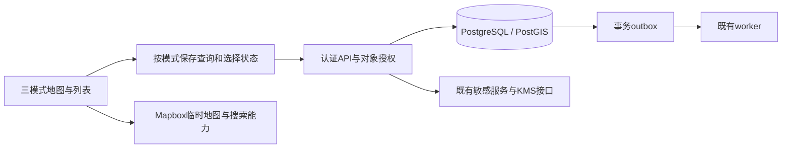

# Abasong V12.1 地图协作架构增量方案

实施范围已拆到[代码差异D01–D14](V3.2_原型到代码差异与实施批次.md)，按[六步门槛](../Abasong_V3.2_可开发与可验收基线.md)推进。实际旧契约/已应用迁移不因本文目标更新而改变；不复制新微服务或恢复集合点。

更新2026-11-05。状态：设计方案，**未修改OpenAPI、DDL、运行服务或云资源**。现行实现见[架构基线](V12_技术架构与开发基线.md)及[B4报告](D2_可用司机与地图找活找人实现.md)。本方案落实[产品收敛](../product/Abasong_V12.1_产品体验升级与需求收敛方案.md)，不把研究中可选能力全部纳入首版。

## 1. 技术负责人结论

继续使用RN/Expo＋Mapbox、NestJS模块化单体、PostgreSQL/PostGIS、已有加密接口和outbox/worker。不引入微服务、H3、Redis、Kafka、新实时通道或额外地图SDK。当前瓶颈是查询语义、状态协调和证据完整性，先修正这些问题。

地图服务提供地理候选，Abasong维护密码来源、适用范围、反馈和业务关联。业务资格、对象授权和解密仍由API执行；不能以客户端筛选、底图分类或普通数据库角色替代。

## 2. 当前与目标

| 范围 | 当前事实 | 后续目标及约束 |
|---|---|---|
| 公寓 | Mapbox＋业务资料附近发现，独立卡、唯一关联、按活动卡查码 | 保留200米、阅读锁、请求代次和对象ID校验；不增加停稳门槛 |
| 找活/找人 | 两类列表分开查询，最多5页×20项；区域点来自已加载结果 | 原型先标当前结果；全量统计接入前不得宣称区域总量 |
| 区域选择 | 点区域主要选中首个已加载的匹配对象 | 目标为真实区域筛选；查询、数字、对象和卡片一起更新 |
| 日期 | 需求查询用starts_at至expires_at与所选日重叠 | 目标改为接手日期；发布截止不是工作结束，须版本化契约与测试 |
| 返回 | 已有筛选、列表及对象记忆 | 补齐任意拖缩后相机恢复；当前并非全部验收通过 |
| 地域几何 | regions有可空边界，现行返回主要为区域点 | 首轮点方案；一处有许可几何只作原型对照 |
| 偏好/机会通知 | 声明与既有消息通知存在 | 持久常跑区、独立机会订阅尚未接；不能复用旧通知默认值偷偷开启 |

## 3. 首个实现批：语义和状态修正

不依赖全量聚合上线即可完成：区域点实际筛选、模式状态隔离、当前结果口径、列表/详情返回、U03快捷日期。保留已有列表接口，接口语义变更必须同步生成器、OpenAPI、类型、HTTP/数据库检查和页面。

客户端每模式保存query、selected_id、列表位置、相机位置/缩放/方向及加载状态；公寓另有阅读锁。筛选变更递增generation，取消旧请求并在回填时复核模式、generation、身份及对象ID。取消请求不等于旧响应一定不会到达。

新查询期间不混用旧卡和新数量；刷新同查询可保留已读对象，但标明读取状态。对象不在当前页只意味着结果变化，不能推断关闭/删除。退出账号清除该身份的结果与敏感内存；不在日志中打印查询中的精确位置、密码或消息正文。

定位按钮：公寓恢复附近推荐；支援只移动相机，不修改筛选、声明或订阅。底图失败与业务读取失败分别处理，不能把失败当成空结果或假无码。

### 3.1 共用卡片轨道与距离（UP12目标）

按[卡片与距离补充](../product/Abasong_V3.2_地图卡片与距离体验补充.md)复用MapCardFrame/MapCardCarousel，内容为公寓/需求/司机变体；这里是R4实现目标，当前仅独立原型有共用HTML渲染/轨道。selected_id与query分离：滑动仅选对象，区域按钮才改筛选；需求关联配送区，司机按用户ID去重并关联声明服务区。列表和地图使用同一有序集合，回程保存ID而非只存索引。滚动结束/迟到回调需核对仍挂载的轨道、模式和当前查询，尺寸变化重算偏移，不重发查码。

复用已有NearbyCandidate.distance_m，不新增按卡调用Matrix。现有数据库查询可取参考点/社区边界/建筑轮廓距离的最小值，因此distance_m不是已确认入口距离；须连同计算依据和定位快照判断显示。目标适配层记录distance_basis（boundary/reference_point）、location_sample_id、captured_at、accuracy_m；契约缺少的依据要先补生成源/类型及HTTP测试，不能推断已存在。位置过期隐藏数值、粗略位置弱化、缺值不补0；会话内使用位置元信息，不记录精确GPS日志。初次排序与标签使用同一依据/快照，阅读锁期间只更新可信参考，不抢选卡。

单位只在展示层从米转近似ft/mi；不把边界距离写成步行/驾驶路线。Mapbox Matrix提供路径距离/时长，点间Haversine或业务PostGIS可计算空间距离，二者不同。找活不显示伪仓库距离，找人不计算实际司机距离。无新依赖、API、OpenAPI或迁移在本轮原型提交中启用。

## 4. 日期契约裁决

- 请求的`starts_at`表示接手开始，`expires_at`表示发帖有效截止；取件/配送截止也不等于司机实际工作结束。
- 新发现查询明确使用`date_basis=handoff_start_date`：starts_at落在所选洛杉矶日期内；同时排除当前已关闭、过期及无权限记录。不要无声改变旧接口`day`含义。
- 可接活声明使用`[starts_at, ends_at)`与所选日期相交，并检查当前active/未到期；未来声明可被未来日期发现，但不叫现在在线。
- 日期区间使用`America/Los_Angeles`的当天零时至下一日零时转换UTC；夏令时日不能写死24小时。时间比较以服务端时钟为准。
- U03开始7天内、单时段不超过24小时；跨午夜显式选择/确认次日，不能悄悄把错误结束时间改成次日。关闭声明不再校验旧时段，保留expected_version并发控制。

本轮不增加“现在”、任意工作时段匹配或日历排班。日期语义测试通过后再在App启用新口径。

## 5. 后续全量发现契约草案

拟新增认证`GET /v1/discovery`，不是本轮已发布接口。`mode=requests|drivers`；date、region_id及对应类型/经验筛选明确归属模式。首版采用**扩展前缀**：limit从20逐次增至100，每次返回完整前缀并替换客户端集合；暂不引入游标快照存储。达到上限需缩小筛选，旧详情/其他上下文接口保留。

建议返回：

| 字段 | 意义 |
|---|---|
| mode、query_key | 服务端按身份和规范化筛选绑定；客户端只能用于一致性比对，不能当授权凭据 |
| generated_at、resolved_time_filter | 数据库读取时间、实际日期范围及date_basis |
| total_unique、region_counts | 当前权限和完整筛选范围下的全量统计，不是加载项数量 |
| items、loaded_count、has_more、next_limit | 有序前缀、实际条数、是否还有及下次上限 |

优先用单条SQL的共同筛选集合同时返回聚合和有序前缀：先执行账号、屏蔽、可见性、版本有效和日期过滤，再聚合，再排序分页，不能LIMIT后计数。若拆为多条SELECT，必须使用同一可重复读快照；普通BEGIN/默认READ COMMITTED不保证跨语句一致。司机愿去多区时，每区分别计数，但跨区total_unique按用户去重；请求条数、缺口人数和件数为不同字段。

region_counts沿用完整当前查询含义；已筛一区就不同时伪装返回其他区未过滤总量。需要其他区预览时另定明确的分面契约，不隐式变更。首版不做跨账号统计缓存。多次扩展前缀不保证冻结数据，generated_at不等于快照ID；新数据/到期可改变次序，客户端按ID更新并保护正在阅读对象。

超过100条、同司机跨区、期间新增/关闭、账号权限变更、相同时间稳定ID排序均需真实HTTP/PG验证。契约启用前“当前结果”继续合法，不能先换成全量文案。

## 6. 区域资料和地图边界

区域目录必须完整处理next_cursor，`limit=100`不意味着已读取全部目录。regions边界可空，保持仅区域点可用。拟增加geometry、geometry_version、geometry_kind及source_reference；元数据记录来源、许可、核对日及生效版本。

几何类型限合法MultiPolygon/4326，检查闭合、有效性、多部件和展示点。只有明确界定的服务区才叫service_definition；行政边界只能叫administrative_reference，不能冒充某DSP的承包范围。几何简化仅用于绘制，不能改变业务归属。

首个区域样本可由版本管理的授权GeoJSON提供，不建设区域运营工作台，不描摹DoorDash分区，不把临时Mapbox搜索结果批量永久保存。永久地理数据沿用已核对的许可配置或其他允许持久化来源；自行生成ID并不能消除来源限制。

## 7. 私人偏好、声明和未来机会通知

拟议`/v1/me/work-preferences`仅owner读写preferred_region_ids（可空、最多5）与expected_version。偏好不会自动发布声明，不更新浏览筛选或历史经验；先补B5本人最小资料编辑，不以偏好代替。

机会通知是独立默认关闭的后续订阅。可基于首次发布/重开等已授权业务事件、共同区域和明确可接时段生成候选；首版保守要求接手时刻在有效声明内，不把发布截止拿来推导配送工时。承运商经验只作自报条件，不视为官方资质。无需位置轨迹。

利用既有outbox/worker；首次提醒按请求＋接收人＋类型幂等一次，声明频繁修改不重复轰炸。重开是否再提醒另定策略。投递前复核账号、屏蔽、当前订阅、声明版本/到期、请求状态和设备绑定；取消或关闭后排队消息应失效。锁屏仅通用文字，点开重新认证读取。不能携带密码、私人碰面点、正文或精确GPS。没有真实推送凭据时继续关闭投递，模拟受理不当送达。

### 7.1 仓库取件位置值对象与外部导航

UP11见[仓库取件补充](../product/Abasong_V12.1_仓库取件地址与导航补充.md)：当前pickup_region_id/area只有大致区域，不是仓库地址。拟在Request及条件版本保存pickup_location（仓库/联系交接、可选名、确认地址、可空目标点、来源），同步发布/编辑/复制/详情与版本事件；不建全城仓库表、不使用旧集合点接口。发布者改地址后客户端旧图失效，导航前使用当前版本，不把浏览旧来源卡当当前地址。

有权的登录司机在报名之前可看发布者提供的商业取件地址，不复用公寓查码资格；公开摘要/分享页/锁屏仍仅大致地区，严格DTO白名单。用户手工确认地址与供应商地理结果分来源，永久存点遵循现有许可；无点允许保留明确地址，禁止区域中心冒充仓库。取件方式切换清理不应展示的旧仓库值，历史条件版本保留。

客户端复用Mapbox预览及固定模板构造Google/Apple Maps外链，不执行任意输入URL、不附账号/token/本人精确GPS，不需新增Navigation SDK或首版路由/ETA接口。复制需明确点击，取消/不可打开保留详情；原生兼容在R4实际验证，不把成功打开当到场。Google通用Maps URL无需API key，外链失败按RN Linking处理，技术依据列于补充文档。

## 8. 数据、权限及发布顺序

本方案不修改既有加密边界，不扩大普通API/worker读取密文的权限。未来偏好/几何表变更需独立增量迁移、owner/公开元数据权限检查；不改已应用迁移，不用D0脚本连接云库。全量聚合从同一可见集合得出，避免统计泄露被屏蔽或不可见记录。

顺序：原型确认→状态/日期与区域筛选→有依据的几何增量（确有价值再接）→全量聚合→偏好/相关提醒。每批独立PR，可按旧接口回退；保留必要兼容，不以切换环境名绕过KMS保护。云端仍保持旧部署，任何迁移/部署遵循原环境授权，不因方案存在自动执行。

## 9. 实现时验收清单

1. 模式/身份切换、慢响应、快速切卡、后台恢复不串对象；返回相机与列表一致。
2. 100项上限、跨区去重、同快照计数、屏蔽/过期及目录下一页均正确。
3. 接手日与有效截止分离，DST两类切换日、跨午夜及未来声明均正确；关闭无效旧声明可成功。
4. 声明/偏好版本冲突409保留本次输入；跨账号不能读写私人偏好。
5. 无/坏/多部件边界可回退点；许可/版本与展示一致，行政边界不冒充业务服务范围。
6. 通知在入队后关闭/过期/屏蔽/设备换绑均停止不合规投递；KMS失败不得假成功。

以上为后续测试要求，**不是本批测试结果**。执行批次见[原型升级与验收方案](../product/Abasong_V12.1_原型升级制作与验收方案.md)。

## 司机圈目标增量（UP13，B5，尚未改契约）

现有PostInput仅body/request_id；posts/comments初始表已定义，不证明真实帖子服务已接。D15拟新增可选topic枚举与region_id（复用regions，非GPS），校验1–2000字正文/1–1000字回复、有效标签/地区及request_id本人可引用对象。用新增迁移，不原地改0001；同步生成源/OpenAPI/类型/真实HTTP和DB授权测试。

Post中的request目前引用完整Request，目标需换独立RequestReferenceSummary白名单：ID/版本、类型、区域、报价单位、接手时间、缺口及当前状态/可查看性；不得把公寓正文、联系方式、精确GPS或仓库完整地址随帖子列表传出。详情另外鉴权。引用读取使用当前请求而非发帖时正文副本；列表权限、双向屏蔽、移除、到期与对象鉴权一致，失败/不可见不能返回旧敏感字段。

帖子/回复按稳定created_at+ID分页、幂等提交、防重复、软删除与作者/运营权限；删除不是静默删整条需求或消息。列表翻页/刷新按ID去重并保护阅读位置，不能因新回复自动顶走正在阅读的动态。客户端过滤只改善显示，服务端执行对象授权。

D16复用outbox/notifications，定义circle_reply对象为目标post并携带最小comment引用，不含正文/门码/收件人；不向本人发自回复通知，同一评论/接收人去重。生产与投递/打开时复核可见性、屏蔽、账号/设备绑定与偏好；已删除/移除显示真实状态。锁屏通用文字，真实推送凭据/送达仍B6。复用现有举报、屏蔽、资料/会话，不新增关注、点赞或推荐服务；媒体按下节D17增量实现。

普通文字草稿首版只在当前账号会话内保留，注销清除；不新增跨设备草稿接口，不恢复截图跨次续填。原型的明确门码正则只是合成演示，不能视为完整隐私检查或安全实现。具体产品与验收见[司机圈补充](../product/Abasong_V3.2_司机圈定位与最小社区补充.md)。

## 司机圈私有图片目标（D17/UP14，B5，尚未接服务）

用户批准文字必填＋0–3张静态图，回复不支持图片。createPost目标增加有序media_ids，媒体不是公寓密码导入批次，也不接受用户输入任意图片URL。拟有创建上传、确认处理和按帖子权限读取接口，具体operationId/OpenAPI/生成类型/增量迁移在B5同时落实，本批没有修改契约。

媒体对象最少：media_id、owner、用途circle_post、状态、服务端生成的私有存储引用、尺寸/格式、校验结果、过期时间；post_media保存post_id/media_id/顺序。未发布媒体仅owner可见；上传确认不等于发帖。所有图片ready且属于当前用户、有效、未绑定其他帖子且≤3时，createPost同事务关联；client_submission_id重试同一内容得到同一帖子，换内容须新提交意图。已有就绪图片可复用重试，失效后保留本地来源重新处理，不冒充成功。

媒体资源放私有对象存储。上传授权仅限服务端生成的单个对象/短有效期/大小用途，不授予列举或读取任意键；真实解码、格式/尺寸限制和服务端重新编码，去除EXIF/GPS，生成缩略/查看版本，不公开原图。初始建议标准化长边≤2048px、单张传输≤5MB，作为可配置工程起点，须真实照片可读性验证后冻结，不能据此声称已验证图像质量。只接支持解码的静态照片；HEIC在可解码端转换，失败明确返回；不接GIF动画、SVG或任意文档。原型TEST SVG不是生产上传格式许可。

首版通过鉴权图片读接口逐次核对媒体/帖子可见性、本人草稿、删除和双向屏蔽后输出受控图片，不发永久公网地址，不使用可共享的公开缓存或密码资格替代帖子权限。客户端只保留短会话显示，注销/屏蔽/删除清图；已送到设备的像素无法远程抹除，不宣称阻止截图。后续若转短签名URL/CDN，必须先明确有效期与撤销窗口，不能宣称旧签名地址瞬间失效。

生命周期覆盖待上传、处理中、ready、attached、failed和受控删除/过期；后台按TTL清理孤立上传和弃稿，删除帖子立即停止新读取、异步清理文件。发布/上传中断使用客户端代次和服务端幂等核对，真实请求超时不能直接判为没写入；HTTP/DB须覆盖跨账号盗绑/读取、超3张、伪类型、过期、并发重复、部分失败、删除/屏蔽后访问和清理误删保护。普通密码贡献的无撤回规则不等于动态不可删除。

图片正文/存储凭据/原始URL不进日志、公开分享DTO或锁屏通知。复用现有举报与移除，不增加逐图人工审核或独立工作台。对象存储、运行权限、费用与云发布材料在B5实际方案确认；本批不创建资源、不授IAM、不上传用户文件或部署。详情：[图片补充](../product/Abasong_V3.2_司机圈图片发布补充.md)。

## 我的简化、手动地址与DSP团队目标（D18/D20；D19取消）

[最新产品补充](../product/Abasong_V3.2_我的与团队资料补充.md)。B5不建设私人联系人名单/备注；已有contacts表、规划operation及历史数据保留，本批不改OpenAPI/生成源/迁移，不为删菜单回滚数据库。首次沟通复用已有会话，屏蔽/举报/解除保留；设置入口按记录存在显示不替代服务端双向阻断。

个人用途、经验、私有联系方式、团队代表权限与公寓资格分开。Auth phone不复制到公开Profile/Driver/Request。DSP字段仍需本人owner/object授权、独立业务联系DTO、默认off、版本/幂等和受控加密读取；公开发现/列表/帖子引用/分享/推送不返回号码。当前团队联系方式另鉴权，历史来源快照不因改名覆盖。成员/收费不启用。

我的接活开关复用既有availability服务和expected_version，不新增online状态或派单。开启仅进入填写，确认成功才开启声明；取消/错误不提前推荐；关闭请求失败保持原声明并可重试，成功不删除报名/会话。未来/到期按同一时区时段判断，退出/迟到写入与版本冲突分别验，不能用用途勾选代替权限。

B02通用手填地址为空，联想可复用已有地址搜索适配；首页卡预填显式选中的业务ID。候选选择/更换均重置来源确认，保留值与门别；无候选允许同页核对完整地址，歧义不猜最近公寓。临时地图候选只用于会话，需持久化时沿用永久地理编码许可和业务关联事务。提交必须有已确认目标/完整新地址、共享资格、来源声明和幂等键；真实端不信任客户端targetId。输入变化不在blur时重建已按下的候选，取消/失败保留来源上下文；网络超时不能直接判没写入。

卡片继续读取既有distance_m及依据，转换为近似m/km，城市复用辅助行；前台去掉至边界/直线不删除内部依据，不等于路径/入口/到达。GPS漂移/快切/迟到响应的对象与代次保护不变，不增加Matrix逐卡调用或伪造未知地址坐标。

本批仅独立合成原型；真实HTTP/PG须验证跨账号资料/团队写入、联系方式默认/关闭/屏蔽后不泄露、版本/幂等/退出隔离及新地址正确关联；双端键盘/返回/真实地图和B6账号/云加密仍另验。无App/依赖/资源/IAM或费用变更。

## 产品邀请技术目标（D21，方案未实现）

[邀请方案](../product/Abasong_V3.2_邀请司机功能方案.md)采用通用HTTPS邀请链接/通用二维码邀请图、RN系统文案分享、复制和公开介绍页；首版不新增个人邀请表/认领API或第三方归因SDK，不复用需求分享token/业务DTO。公开payload无个人标识、联系方式、门禁、精确位置、账号凭证或需求/仓库对象。

现有Expo Linking/路由可作为基础，实际需按构建/主机配置受限路径的Universal Links/App Links和网站关联文件，并核对真实分发入口。当前配置未打通邀请域名，不把普通scheme或页面打开算成安装/首启恢复。图片可预制打包，保存权限/必要模块在实施时单独核对；微信真实目标/浏览器行为需要双端测试，不保证系统回调代表外部发送。

配置的发布阶段、已开放功能、平台URL、邀请图版本同源；只允许受控HTTPS跳转及渠道白名单，避免query开放重定向。没有可用包/实际核心流程时不扩大外发；不向外提供本地Metro/API地址。邀请不改变bootstrap、capabilities、团队代表权或报名，不建立常联系名单。来源链路缺失记未知，不用指纹、剪贴板读取或号码匹配补个人归因。

本批未改App/原型、API/生成源/迁移、DNS/证书/主站/云或权限，也未安装依赖/发送邀请。未来托管、关联域及资源方案需具体核对；这里只准备材料，不增加费用授权。技术来源及AC-I01–14见方案，真实双端/分发验收仍未执行。
