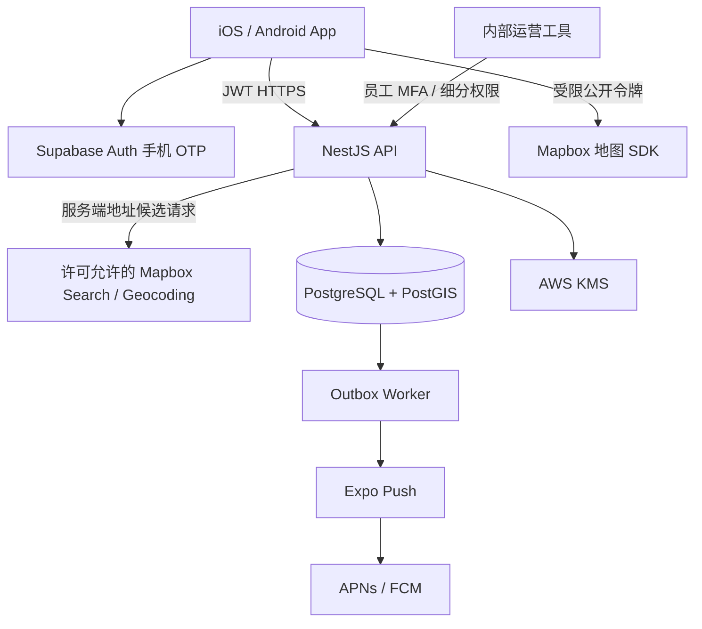

# Abasong V12 技术架构与开发基线

日期：2026-10-29。状态：面向实现的技术设计基线，尚未部署或通过真机/生产验收。产品依据：[PRD V12](../../Abasong_PRD_V12_首版产品需求.md)。本文取代 V9 的技术候选与旧履约事件，不改变已批准产品范围。

当前补充：[V12.1页面与契约对齐](V12.1_页面梳理与契约对齐.md)。业务只做临时配送支援/灵活用工，不做长期招聘。公开摘要、最低承接量、取件区域等以该补充及12.1.0契约为准。

## 1. 技术决策

| 层 | 本版选择 | 原因及限制 |
|---|---|---|
| 客户端 | React Native + TypeScript + Expo development build | 一套业务代码服务 iOS/Android；真实地图需要原生构建，不使用 Expo Go 验收 |
| 原生地图 | `@rnmapbox/maps` 封装 Mapbox 原生 SDK | 社区维护封装，非 Mapbox 官方 React Native SDK；原生兼容、许可和真机验证是依赖门槛 |
| 地图数据 | 经验证的 Mapbox 样式/Streets v8 + 自有公寓图层 | 不把一般住宅全部推断成公寓；供应商临时结果不直接写入永久库 |
| API | Node.js LTS + NestJS + TypeScript，模块化单体 | 一处执行权限/规则与事务；首版不做微服务 |
| 数据库 | 美国区域 Supabase 托管 PostgreSQL + PostGIS | 空间索引与关系事务；Supabase 仅承担 Auth 和数据库，不把业务表开放给客户端 |
| 认证 | Supabase Auth 手机 OTP；美国短信默认采用 Twilio 供应商 | 实施前核实账号、发送资质、费用、限流和实际交付；不自建短信验证码算法 |
| 消息 | 自有消息表 + HTTPS 游标拉取；前台会话短轮询 | 首版无 WebSocket 集群、无输入状态与读回执；只读未读进度和发送状态 |
| 推送 | Expo Push Service → APNs/FCM | 设备令牌、ticket/receipt、失效清理；推送仅提示，消息库为事实源 |
| 异步任务 | PostgreSQL transactional outbox + 独立 worker | 与业务同事务写事件，至少一次处理、业务去重；首版不引入 Redis/Kafka |
| 云部署 | AWS us-west-1，ECS Fargate API/worker，ALB/ACM，CloudWatch，KMS/Secrets Manager | 2026-10-30用户新建北加州Supabase开发项目，部署计划改为同区；AWS资源尚未创建，连接方式与出站预算在部署清单冻结 |
| 密钥与字段加密 | KMS 管理的密钥 + 应用层 AES-256-GCM 信封加密 | 密码和私聊正文加密存储；授权后 API 才解密；数据库备份不能直接读正文 |
| 工程 | TypeScript 单仓，`apps/mobile`、`apps/api`、`apps/worker`、`packages/contracts`、`packages/ui` | 此为目标目录，尚未创建应用工程；现有 HTML 为设计演示 |

不冻结未经构建的“最新版本号”。D0 建立 `dependency-lock.md`：Node LTS、Expo SDK、React Native、地图封装与原生 SDK、Xcode、Android Gradle/JDK、PostgreSQL/PostGIS 的精确版本，以及双方平台构建结果。版本相互兼容后提交锁文件；不得直接安装 floating latest 作为正式交付。

## 2. 系统边界

客户端可以直连 Auth 与地图 SDK；所有业务数据经 API，不能直连 Supabase Data API/Realtime 读业务表。`abasong` schema 不列入 Data API exposed schemas，撤销 `PUBLIC`、`anon`、`authenticated` 的权限。业务运行角色不是迁移 owner，不持有 `BYPASSRLS`，不使用 Supabase service-role key 执行普通业务查询。

首版采用服务端对象授权 + 数据库角色/schema 隔离。当前迁移启用 RLS 默认拒绝直接客户端访问，并只为受信运行角色设服务策略；**该策略本身不是用户级行授权**。对象/字段权限必须由 API guard/policy 与查询范围执行并有越权测试。切勿声称“有 RLS 因而 API 不必鉴权”。未来直连客户端需要单独迁移和用户级策略，不属于本架构。

## 3. 模块与责任

| 模块 | 唯一负责内容 | 禁止跨越的边界 |
|---|---|---|
| Identity | JWT 验证、用户同步、封禁、删除、资格/能力、员工权限 | 不从显示名、手机号或客户端字段推导 DSP/员工权限 |
| Apartments | 公寓、别名、范围、候选匹配、地点纠错、数据来源 | 不把第三方临时数据借自有 ID 永久化 |
| Access | 进入记录、加密、资格、反馈事件、排序、撤回、复核 | 地图接口和公开卡片不返回密码正文 |
| Requests | 草稿、发布、条件版本、截止、剩余缺口、终态 | 不自动转派、派单、结算或判断到场 |
| People | 主动可用时段、区域、容量、经验、常联系 | 在线不等于可接活；不建立实时轨迹库 |
| Conversations | 两人会话、来源需求、文字消息、已读水位与屏蔽 | 不群聊、不导出联系方式、不以推送成功判定用户收到 |
| Circle | 文字动态、回复、引用需求 ID、审核删除 | 不另造一套招募状态，不做生活交易市场 |
| Notification | 站内事件、推送偏好、设备、去重与回执 | 不带密码/精确位置/私聊正文到锁屏 |
| Moderation | 来源核验、内容举报、撤回、对象复核、审计 | 员工不能无理由浏览全部密码/对话 |

## 4. 关键流程与事务

### 4.1 登录与账户

客户端调用 Auth SDK 发起 OTP/校验，refresh token 保存在系统安全存储，不进入日志。API 校验签名、允许算法、issuer、audience、exp/nbf、sub；使用已配置非对称签名和 JWKS，不接受客户端传 `user_id` 作为身份。JWT 合法后仍检查本地账户状态、会话失效时间/资格截止；封禁立即阻止敏感请求，不等旧 JWT 过期。

`POST /v1/me/bootstrap` 幂等同步 `sub`，只建立本人基础资料；不能自授贡献资格或员工权限。后台 Auth 管理 API 仅用于受控删除/恢复等工作流，与普通数据库凭据隔离。手机登录与实际配送资格分开，试点由邀请/运营审核授予时效性能力。

### 4.2 到公寓查资料

App 获得前台位置及时间/精度 → `POST /apartments/resolve` → 自有可信几何/地址匹配 → 返回 `matched/candidates/unknown/stale_location` → 有权限时 `GET /apartments/{id}/access-records` 获取受控正文。匹配响应无密码；查询并行不等于取消授权。

位置不持久化为个人轨迹；请求/错误日志删除经纬度和地址搜索原文，保留匿名场景/错误类别。精确位置只作当次匹配；选择锁定由客户端持有公寓 ID，GPS 更新不抢走阅读。没有可用阈值配置时关闭自动匹配，回退候选，不能用固定“最近 50 米”冒充验证。

密码在 `access_records` 的公开元数据之外，存 `access_secrets` 密文；读出顺序为对象权限→状态/有效期/适用范围→排序→解密必要条数。返回 `Cache-Control: no-store`；不在服务端通用缓存、客户端持久 Query 缓存和崩溃上报保存正文。内存阅读缓存关闭/撤回/退出后清空。密钥失败返回明确服务不可用，不降级明文或邻栋码。

### 4.3 添加与反馈

规范化保留密码的 `#/*`、大小写等必要字符；公寓 ID + 适用范围键 + 密码规范值进行 HMAC-SHA-256 去重。HMAC 密钥不同于加密密钥；不使用可离线枚举的普通 hash 存低熵门码。范围由门别/时段规范化生成，不能把不同范围合并。

事务：锁定/插入记录 → 若同码同范围存在，仅新增贡献验证事件 → 写审计/outbox；不改 `contributed_at`。首次来源声明保留。同一人同一记录的当前反馈唯一，历史事件 append-only；反复反馈不刷票。

排序精确为 `(has_current_effective_useful DESC, contributed_at DESC, id DESC)`，不是按票数或最近编辑时间。有效窗口、滥用排除、适用范围与失效审核共同计算。试点需要明确 `feedback_window_days`；配置未定不能公开声称“今天有效”。确认撤销/失效立即使正文不可读；已下发资料不能保证从用户记忆或截屏中撤回，因此不批量下发。

### 4.4 发布、报名与更新

草稿属于本人；发布事务校验条件/本人资格→记录版本→开放→写 outbox。发布和每次关键变更创建不可变的去敏快照：区域、报价、数量、时段、单位、接手条件；快照不得含密码、精确集合点或私人联系方式。

更新需要 `expected_version`，数据库用 `UPDATE ... WHERE version=$expected`，不匹配返回 409。报价改变通知已有报名者，但不自动等于对方接受。名额/包裹缺口由发布者确认，不按报名数扣减。报名唯一约束 `(request_id, applicant_id)`，撤回后重报复用一行、保存事件；已关闭、已到期、本人的需求不能新报名。

报名与必要两人会话在同一事务完成。匹配同一对用户可复用会话，来源需求作为独立关联卡保存，避免因一人同一天两条需求建立无数会话。`pair_low/pair_high` 排序唯一，自己不能与自己建会话；屏蔽检查覆盖创建、报名及发送。双方自愿在线下转派，不在 App 创建交接完成状态。

### 4.5 消息与异步事件

`client_message_id`（UUID）+ sender 唯一保证移动网络重试不重复。消息写成功才返回服务端 `message_id`；服务端接受不是对方已读。message sequence 单调，用于增量同步与已读水位；未读计算不能包含本人发送。

业务事务中写 outbox，不同步等待推送。worker 用 `FOR UPDATE SKIP LOCKED` 领取及租约/重试，发送使用事件 ID+接收人+渠道去重；崩溃可能造成重复外部通知，客户端仍按事件 ID 去重，不承诺 exactly-once。Expo ticket 表示接受，receipt 表示供应商交付情况，均不证明司机看见。失效 token 停用，429/5xx 退避，不可恢复错误进失败队列并报警。

前台当前会话目标 5 秒增量拉取，其余消息列表目标 30 秒；失焦/后台停止轮询，推送唤醒后刷新，网络失败指数退避。这是配置起点，不是承诺实时 SLA；负载测试后可调整。将来确有需求再加 WebSocket，不改事实源。

### 4.6 到期、删除与撤回

查询端始终检查 `expires_at > now()`，worker 延迟不能让过期任务或可用司机仍被返回。worker 只把数据库状态推进到终态与发一次事件。用户手动声明可用的状态不依赖 App 心跳。

账号删除事务立即禁用本人访问、关闭可用性/开放需求、撤回本人进入资料、安排 Auth 删除和身份去标识；聊天中双方历史按冻结留存策略处理。硬删除不是简单级联清除所有共同会话。对外状态 202 与删除任务 ID，不假称已即时清除所有备份。

## 5. 配置、数据与服务指标

所有日期 UTC 存 `timestamptz`，任务另存 IANA 时区，默认 `America/Los_Angeles`；夏令时由时间库处理。金额用整数 cents，`per_parcel/per_route/negotiable` 单位分开，数量与停靠数分开。空间坐标 WGS84，GeoJSON `[lng,lat]`，米为服务端距离计算单位、mi 为显示单位。

建议内部目标：自有查询 API P95 < 800ms（不含外部地图），暖切回到卡 P95 < 2s；正式验收阈值需在标注样本及设备实测后冻结。统计 `resolve→candidate/selected→access_loaded→feedback`，不记录码正文、个人轨迹或精确住户地址；分开用户位置错/供方缺失/自有匹配错。

配置至少含：有效反馈天数、定位最大年龄/误差、自动匹配阈值/候选差、查询条数、任务最大期限、轮询/退避、每账号/设备/IP 限流。初始安全规则：候选不确定则不自动命中；每次仅查看当前公寓记录，默认 10/最多 20，不能遍历下载整库。具体阈值与限流在试点冻结记录中明确，未冻结项目阻止公开上线。

## 6. 环境、发布与恢复

- dev/staging/prod 使用不同 Auth 项目、数据库、Mapbox token、KMS key、推送项目与域名；不能用生产密码作为测试夹具。
- 运行时 Secrets Manager 注入服务端秘密；移动包只有允许公开且受限的 publishable/Mapbox token。Mapbox 构建下载 token 如当前版本要求，仅供 CI，不进包。
- API 与 worker 同镜像不同 entrypoint；CPU/副本、ALB、NAT/出站、日志与 DB 连接均入预算。首版至少能人工停止发布和回退镜像，不能只依赖自动扩缩容。
- SQL migrations 单独角色顺序执行，先扩展兼容字段再切 API，最后回收；生产不运行任意 down/drop。应用回滚要求 schema 向后兼容。
- DB 备份/PITR 以所购计划实际能力配置，目标 RPO 24h / RTO 4h 为首版提议，必须恢复演练并获运营接受。KMS 权限/备份若缺失，即使 DB 恢复也不能读密文；演练包含密钥引用恢复。
- 结构日志：request_id、actor匿名标识、对象 ID、动作、耗时、错误类。禁用请求体自动收集、SQL 参数、Authorization、OTP、精确位置与正文。审计日志也不能塞完整密码。
- 告警：5xx、鉴权异常、解密失败、DB 连接池、outbox 最老年龄/死信、推送不可恢复错误、外部 API 费用/调用异常、错栋样本。

## 7. 实现与验证

数据库与接口契约见本目录配套文件；当前 SQL 是初始结构迁移，权限和状态变更仍必须实现应用服务。不能“执行迁移后”就声称报名/反馈并发规则自动全部完成。

至少验证：跨用户读取密码/消息/报名失败；撤销资格立即不可查；伪造 JWT/员工权限失败；连接池上下文不串用户；重复报名/消息/反馈不重复；并发关单与报名；更新版本冲突；贡献时间排序；到期与推送延迟；KMS失败；供应商授权；备份恢复；真机地图/字体/弱网。

当前环境没有正在运行的 Docker/PostgreSQL，不能声称已完成实际数据库执行和 RLS 集成测试。交付报告分别记录语法/结构校验与待运行的数据库/真机测试。没有购买云服务或修改任何已连接 Supabase 项目。

## 8. 官方依据与不确定项

本次访问核实：[Expo development builds](https://docs.expo.dev/develop/development-builds/introduction/)、[RNMapbox 安装与原生构建要求](https://rnmapbox.github.io/docs/install)、[Supabase JWT 验证](https://supabase.com/docs/guides/auth/jwts)、[手机号 OTP](https://supabase.com/docs/guides/auth/phone-login)、[PostGIS 扩展](https://supabase.com/docs/guides/database/extensions/postgis)、[PostgreSQL RLS](https://www.postgresql.org/docs/current/ddl-rowsecurity.html)、[Expo 推送与回执](https://docs.expo.dev/push-notifications/sending-notifications/)、[AWS KMS 密钥](https://docs.aws.amazon.com/kms/latest/developerguide/concepts.html)。

NestJS Swagger 文档页面本轮可访问但正文未成功提取，因此不据此声称某个生成器版本已验证。OpenAPI 文件作为独立契约，框架版本与生成同步在 D0 做构建验证。各官网功能存在不等于项目已获得账号、许可或交付保证。

## 2026-10-30截图P0扩展待实现

[截图批量贡献补充](../product/Abasong_V12.1_截图批量贡献需求补充.md)已纳入首版。技术架构需新增本人导入批次、私有源文件、加密候选、异步处理、集中确认和逐项幂等提交；与现有贡献事务、资格、排序和审核规则复用。明文手动编辑仍仅内存；导入批次允许有限保留的服务端加密草稿，不能放宽通用缓存策略。

新增接口/状态/限额及保留期在T27冻结，OpenAPI源/生成器需一起更新；新增实体用后续迁移，不改已在本地应用的0001。本轮未修改OpenAPI、执行SQL、选择OCR服务或实现worker，现有契约没有因此自动支持截图导入。

## 私人库与导入增量设计（待实现）

私人库、导入草稿和共享链路分别建模；对象边界与两阶段提交见[实施设计](V12.1_私人库与导入实施设计.md)。当前OpenAPI尚未包含新增接口，不能当作服务已存在。
