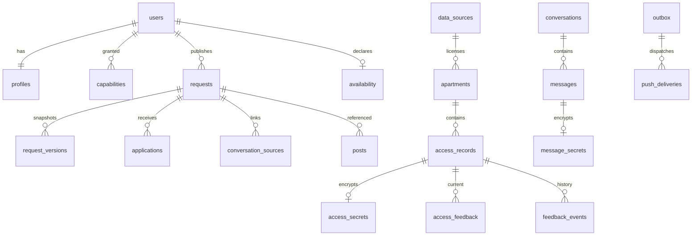

# Abasong V12 数据库设计与事务规则

日期：2026-10-29。配套：[架构](V12_技术架构与开发基线.md)、[SQL 初始迁移](../../database/migrations/0001_v12_initial.sql)、[接口契约](openapi-v12.yaml)。状态：结构设计及迁移草案，实际数据库执行/性能与权限集成仍待验证；不向任何已连接项目自动应用。

当前增量见[V12.1对齐](V12.1_页面梳理与契约对齐.md)：只做当次临时支援；增加最低承接量、经验要求、取件区域、公开分享和草稿软丢弃。没有长期招聘/带教/试线表及字段。

## 1. 数据原则与模型

PostgreSQL 关系模型为业务事实源；PostGIS 存合法的自有几何与空间索引；第三方临时地址响应不持久化。账号使用 Auth `sub`，由服务端 bootstrap 同步，不跨托管 Auth 内部表建立易受供应商迁移影响的外键。所有用户行为必须能追溯到已验证账号；不收集承运商登录口令。

## 2. 表分组与数据字典

SQL 是字段/类型/约束的机器可读来源；本节解释用途及不能由 DB 自动完成的规则。

| 表 | 用途 | 核心约束/索引 |
|---|---|---|
| users / profiles | 账号状态与最小公开资料 | Auth sub 主键；封禁/删除状态立即查 |
| capabilities | 工作资格与员工细分能力 | 截止、撤销；来源理由与授予人；不能本人自授 |
| organizations | 最小 DSP 来源与具体联系人 | 审核状态不在普通资料更新字段中 |
| regions | 服务区域及展示中心 | 多边形/区域点；不是司机 GPS |
| data_sources | 可持久化数据来源及许可 | 必须明确 persistent_use_approved；Temporary 不入表 |
| apartments / apartment_aliases | 独立公寓 ID、多楼社区、地址别名 | Point/GiST、Boundary/GiST；合并指向同一公寓的规范 ID |
| access_records | 进入记录元数据与去重指纹 | 公寓+范围+HMAC key版本+HMAC 唯一；贡献时间不因验证改写 |
| access_secrets | 进入信息密文 | 单记录一密文；AES-GCM nonce/tag、加密 DEK、KMS key ID |
| access_contributions | 首次及同码贡献事件 | 历史不可修改/删除；验证不改变排序时间 |
| access_feedback / feedback_events | 当前反馈/不可变事件 | 每人每记录唯一当前状态；有效成功反馈局部索引 |
| location_corrections | 错栋与地址更正 | 地址/原因，不保存个人位置轨迹 |
| availability / availability_regions | 主动可用时段与服务区 | user 唯一、起止约束、版本；查询实时判截止 |
| requests | 草稿、发布、报价、缺口、到期与版本 | 数量/单位分开，缺口不能负或超总数；开放区域索引 |
| request_private_details / meeting_shares | 精确集合点密文与明确共享 | 请求正文不带到公开卡；分享到指定已有会话 |
| request_versions | 不可变去敏版本快照 | request+version 主键；只存允许的发布条件 |
| applications / application_events | 唯一报名、当前状态及变更历史 | request+applicant 唯一；报名引用实际版本 |
| blocks | 单向声明、双向生效屏蔽 | 不允许屏蔽本人；创建/发送/通知均检查双方 |
| conversations / conversation_sources | 同一对用户会话及多需求关联 | 排序用户对唯一；不是每个需求都新建一组对话 |
| messages / message_secrets | 消息元数据/加密正文 | sender+client_message_id 唯一，conversation+sequence 增量索引 |
| conversation_reads | 每人每会话已读水位 | 水位不倒退；服务检查参与者和 sequence 所属会话 |
| contacts | 私人常联系与备注 | owner+contact 唯一；不公开给他人 |
| posts / comments | 文字动态与回复 | 状态软删除；需求引用同 ID，不复制招募状态 |
| notifications / notification_preferences | 本人站内事件与偏好 | user+event_key 唯一；偏好只改变推送、不丢站内事实 |
| devices / push_deliveries | 安装实例、令牌与推送回执 | 安装实例唯一；outbox+device 唯一 |
| outbox | 异步业务事件 | event_key 唯一；租约、重试与死信；仅 ID/版本 payload |
| idempotency_keys | 同主体同路由提交去重 | HMAC 请求摘要、返回对象引用；不缓存正文 |
| reports / moderation_actions / audit_events | 举报、审核与访问审计 | 多态对象由 API 校验存在与权限；历史只追加 |
| deletion_jobs | 可观察的账户删除流程 | 每用户一个活跃任务；异步不是瞬间清空 |
| config_versions / schema_version | 参数冻结和迁移版本 | 配置由受控部署/迁移写入，普通 API 无写权限 |

## 3. 数据类型与字段语义

- USD 金额为整数 cents，数据库禁止负数。协商价允许 amount 为空；明确 per_parcel/per_route 时必须有金额；免费 0 仍需发布者明确选择，不用空值推断 0。
- 时间均 `timestamptz`，原任务时区另存 IANA 名称。表单当地时间在服务端解析并处理夏令时重复/不存在时间，不只保存 AM/PM 字符串。
- GeoJSON `[longitude,latitude]`，geometry SRID 4326；距离用 geography 米，不用经纬度欧氏距离计算司机远近。
- `contributed_at`、反馈发生/更新时间、最近成功、最近失败分开。当前反馈可更新，`feedback_events` 不重写。
- `last_success_at` 是事件摘要，不足以证明仍有当前有效票；排序必须查询未撤回/未排除/适用且在窗口内的当前反馈。
- JSON 字段只用于有明确 schema 的自报经验、适用时间、去敏快照及 ID 事件载荷，不能变成塞任意面单或供应商响应的“万能字段”。API 校验允许字段、大小、嵌套深度。

## 4. 状态与数据库之外的业务约束

进入记录：pending → active → review/invalid/withdrawn；review 需核验后回 active 或 invalid。确认失效或无权不再解密。pending 不是可用密码；资格和来源可信时可按审核规则直接 active，但不能伪装官方验证。方法 no_fixed_code 也只描述有权分享的进入方式，不集成解锁。

需求：draft→open→found/closed/expired。重开仍复用 request ID、递增 version，要求更新有效时间并重新发布校验。kind/publisher 发布后不可修改，防止把整线报名悄悄变成车辆求助。

应用层必须实现：

1. 起止/截止与取件、配送时间的合理性；额外司机人数及部分数量字段；是否已到期。
2. 组织来源只能使用本人有权代表的最小组织，不允许猜别人的 organization_id。
3. 报名人≠发布者；报名资格、屏蔽、数量可行性、所见版本及当前状态。
4. 会话参与者与需求来源相符；消息发送者确为参与者；已读水位属于该会话。
5. request_versions 的 snapshot 仅从白名单 DTO 生成，不能保存精确集合点、私聊或密码。
6. 多态举报对象的存在/可见性与有效审核动作；不让员工因不相干权限查看所有私聊。
7. 同码规范范围与跨 HMAC 密钥轮换去重；SQL 唯一键不能自动跨版本匹配。

SQL CHECK 仅保证局部结构，不能代替上述跨表对象权限及状态机。普通服务角色没有 DDL/角色管理/TRUNCATE 权限；服务端仍是可信计算边界。

## 5. 事务与并发实现要求

| 操作 | 事务及锁 | 冲突结果 |
|---|---|---|
| 同码贡献 | 稳定公寓/范围 advisory 事务锁；按当前及迁移期 HMAC 查找；插入或追加贡献事件 | 不重复记录、不修改首次贡献时间 |
| 反馈切换 | 锁 access_record 与本人 feedback；先记录状态再追加事件/outbox | 重试同一意图不累计票；以服务端提交时间为准 |
| 条件修改 | UPDATE request WHERE publisher/version 匹配；写 version 快照和 outbox | 0 行返回409，不静默覆盖 |
| 报名与关单 | 先 `SELECT request FOR UPDATE`，再查状态/截止/屏蔽/资格 | 关单先提交则拒新报名；报名先提交则保留历史，随后终态可见 |
| 缺口修改 | 版本更新与非负约束；独立于报名数量 | 不发生负数，找齐需明确标记found |
| 两人会话 | 规范 pair_low/pair_high，INSERT ON CONFLICT 后读取 | 同一对并发只建一会话 |
| 消息重试 | sender/client_message_id 唯一；比较原意图 HMAC或一致DTO | 相同重试返回已有；不同内容同ID返回409 |
| 任务领取 | 短事务 SKIP LOCKED 领取/租约；外部调用不占长事务 | 租约超时重试；按event_key去重 |

所有业务变化和 outbox 同事务提交。敏感表使用独立数据库角色并不要求跨数据库：同一事务先用受控角色切换或专用联合权限事务账号执行元数据+密文写入；不能通过两个独立连接假称原子提交。推荐使用专用 `abasong_sensitive` 登录会话，在允许的敏感业务事务内临时 `SET LOCAL ROLE abasong_api` 处理元数据，再切回敏感角色处理密文；部署登录必须获这两个 NOLOGIN 角色 membership，普通 API 登录只获 `abasong_api`。每个语句参数化，敏感连接池只暴露给已授权服务，禁止通用 SQL 入口。具体数据库供应商的角色 membership/SET ROLE 必须集成测试。

## 6. 加密及去重密钥轮换

生成 256-bit DEK 后 AES-GCM 加密，96-bit 随机 nonce，每个 DEK/nonce 组合唯一。AAD 固定含环境、用途、对象 ID、cipher_version，绑定记录防止密文换行。仅保存 ciphertext/tag/nonce/encrypted_dek；DEK 明文只在请求内存短存，禁止落盘/日志。

KMS key 轮换可先重新包裹 DEK；如换算法/数据密钥则逐条重加密，迁移支持旧版读取，完成校验再回收旧授权。不能提前删 KMS key 导致备份永久不可读。

去重 HMAC key 单独保存在密钥服务，轮换过渡期间双读旧/新指纹、单写新指纹并锁同公寓范围；完成已有记录指纹迁移后再移除旧 key。HMAC 本身也不返回客户端。低熵门码的明文或无密钥 hash 都不应进数据仓库。

## 7. 留存、删除与恢复提议

以下为开发默认提案，公开试点前由负责人冻结，不宣称法律规定期限：

| 数据 | 建议策略 |
|---|---|
| 当前设备定位 | 单次匹配使用，不持久保存个人轨迹 |
| 密码明文 | 不持久保存；撤回立即阻止解密，进入记录保留去敏审核状态 |
| 撤回密文 | 待异议/滥用复核期后清除密文，建议30天；备份随到期轮转 |
| 私聊正文 | 提议180天滚动；共享会话历史删除/去标识须区分双方权利与必要审核，冻结前受控试点 |
| 幂等记录 | 提议24小时，过窗重试需客户端重新读取对象，不能凭旧key假设成功 |
| 临时地址结果 | 不写数据库，不以通用响应缓存存储 |
| outbox/推送回执 | 完成后提议30天，运营统计去标识汇总 |
| 访问/审核元数据 | 提议180天；仅必要人员可读，禁存正文/精确GPS |

账号删除先关闭授权和开放对象，再受控清理/去标识。worker 只有调度/状态权限，涉及撤回密码/Auth 删除/多表匿名化由内部删除处理器在专用受控服务权限下执行；不能给通用推送 worker 全库权限图省事。

迁移文件仅用于新建隔离数据库，禁止在未知已有 Supabase 项目直接执行。生产备份恢复需要演练 DB+密钥+Auth ID 映射，以及在恢复后重放撤回/封禁的安全事件，避免恢复旧备份重新开放无权密码。

## 8. 必须执行的数据库测试

当前交付的静态检查不替代实际 PostgreSQL/PostGIS：需要在隔离库应用迁移，验证空间类型/索引、所有外键/唯一键/检查、普通角色不能读敏感表、Supabase客户端角色默认拒绝、append-only历史不可改、并发事务结果及过期查询。测试样本使用合成密码，不能连接真实司机资料库。
